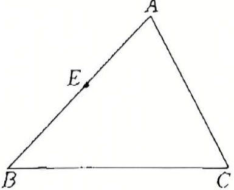

已知：如图，在 $\triangle ABC$ 中，过点 A 作  $AD \perp BC$，垂足为 D，E 为 AB 上一点，过点 E 作 $EF \perp BC$，垂足为 F，过点 D 作 $DG // AB$ 交 AC 于点 G。

(1) 依题意补全图形:

(2) 请你判断 $\angle BEF$ 与 $\angle ADG$ 的数量关系，并加以证明.

> [!question]- 点击查看答案与解析
> 【答案】见解析
> 
> 【考点】平行线的性质与判定、垂线的性质 → [[【初中数学知识点体系-人教版】#7-2 平行线]]
> 
> 【解析】
> **(1) 补全图形：**
> 
> 过点 A 作 $AD \perp BC$，垂足为 D；
> 
> 在 AB 上取一点 E，过点 E 作 $EF \perp BC$，垂足为 F；
> 
> 过点 D 作 $DG // AB$，交 AC 于点 G。
> 
> **(2) $\angle BEF$ 与 $\angle ADG$ 的数量关系：$\angle BEF = \angle ADG$**
> 
> **证明：**
> 
> $\because AD \perp BC, EF \perp BC$（已知）
> 
> $\therefore AD // EF$（垂直于同一条直线的两条直线平行）
> 
> $\therefore \angle BEF = \angle BAD$（两直线平行，同位角相等）
> 
> $\because DG // AB$（已知）
> 
> $\therefore \angle ADG = \angle BAD$（两直线平行，内错角相等）
> 
> $\therefore \angle BEF = \angle ADG$（等量代换）
> 
> 【易错点】不能正确运用"垂直于同一条直线的两条直线平行"这一性质，或者在复杂图形中不能正确识别同位角和内错角。
