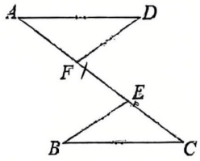

如图， $AE = CF$， $AD = CB$， $DF = BE$，求证： $\triangle ADF \cong \triangle CBE$。

> [!question]- 点击查看答案与解析
> **【答案】** 证明题
> **【考点】** [[【初中数学知识点体系-人教版】#14-1 全等三角形及其性质]]
> **【解析】**
> 证明：$\because AE = CF$（已知），
> $\therefore AE + EF = CF + EF$，即 $AF = CE$。
> 在 $\triangle ADF$ 和 $\triangle CBE$ 中：
> $\begin{cases} AF = CE \\ AD = CB \\ DF = BE \end{cases}$
> $\therefore \triangle ADF \cong \triangle CBE$（SSS）。
>
> **【易错点】** 忘记 $AF = CE$ 的等量代换，直接写 $AF = CE$ 而不说明理由。
