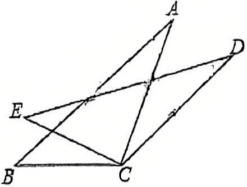

如图，已知 $CA = CD$， $AB = DE$， $\angle A = \angle D$，求证： $\angle BCE = \angle ACD$.

> [!question]- 点击查看答案与解析
> **【答案】** 证明题
> **【考点】** [[【初中数学知识点体系-人教版】#14-2 三角形全等的判定]]
> **【解析】**
> 证明：在 $\triangle CAB$ 和 $\triangle CDE$ 中：
> $\begin{cases} CA = CD \text{（已知）} \\ \angle A = \angle D \text{（已知）} \\ AB = DE \text{（已知）} \end{cases}$
> $\therefore \triangle CAB \cong \triangle CDE$（SAS）。
> $\therefore \angle BCA = \angle ECD$（全等三角形对应角相等）。
> $\therefore \angle BCE = \angle BCA - \angle ECA = \angle ECD - \angle ECA = \angle ACD$。
>
> **【易错点】** 需正确识别 $\triangle CAB$ 与 $\triangle CDE$ 的对应关系，利用 SAS 证明全等。
