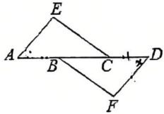

如图，已知 $A$、 $B$、 $C$、 $D$ 四点顺次在同一条直线上， $AE \parallel FD$， $AE = FD$， $AB = CD$，求证： $\angle ACE = \angle DBF$。

> [!question]- 点击查看答案与解析
> **【答案】** 证明题
> **【考点】** [[【初中数学知识点体系-人教版】#14-2 三角形全等的判定]]
> **【解析】**
> 证明：$\because A$、$B$、$C$、$D$ 四点顺次在同一直线上，
> $\therefore AC = AB + BC$，$BD = BC + CD$。
> $\because AB = CD$（已知），
> $\therefore AC = BD$。
> $\because AE \parallel FD$（已知），
> $\therefore \angle EAC = \angle FDB$（两直线平行，内错角相等）。
> 在 $\triangle AEC$ 和 $\triangle DFB$ 中：
> $\begin{cases} AE = DF \\ \angle EAC = \angle FDB \\ AC = DB \end{cases}$
> $\therefore \triangle AEC \cong \triangle DFB$（SAS）。
> $\therefore \angle ACE = \angle DBF$（全等三角形对应角相等）。
>
> **【易错点】** $AC = BD$ 需要通过等量代换推导；注意使用 $AE = FD$ 和夹角 $\angle EAC = \angle FDB$ 来证明全等。
