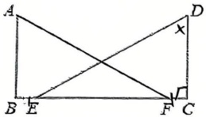

如图， $AB \perp CB$， $DC \perp CB$，E、F 在 BC 上， $\angle A = \angle D$，BE = CF，求证：AF = DE.

> [!question]- 点击查看答案与解析
> **【答案】** 证明题
> **【考点】** [[【初中数学知识点体系-人教版】#14-2 三角形全等的判定]]
> **【解析】**
> 证明：$\because AB \perp CB$，$DC \perp CB$（已知），
> $\therefore \angle ABF = \angle DCE = 90^\circ$。
> $\because BE = CF$，
> $\therefore BE + EF = CF + EF$，即 $BF = CE$。
> 在 $\triangle ABF$ 和 $\triangle DCE$ 中：
> $\begin{cases} \angle A = \angle D \\ \angle ABF = \angle DCE \\ BF = CE \end{cases}$
> $\therefore \triangle ABF \cong \triangle DCE$（AAS）。
> $\therefore AF = DE$（全等三角形对应边相等）。
>
> **【易错点】** 注意 $BE = CF$ 转化为 $BF = CE$ 的等量代换。
