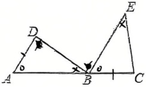

如图，点 B 在线段 AC 上， $AD \parallel BE$， $\angle ABD = \angle E$，AD = BC，求证：BD = EC.

> [!question]- 点击查看答案与解析
> **【答案】** 证明题
> **【考点】** [[【初中数学知识点体系-人教版】#14-2 三角形全等的判定]]
> **【解析】**
> 证明：$\because AD \parallel BE$（已知），
> $\therefore \angle A = \angle EBC$（两直线平行，同位角相等）。
> $\because \angle ABD = \angle E$（已知），
> $\therefore \angle ADB = 180^\circ - \angle A - \angle ABD$，
> $\angle ECB = 180^\circ - \angle E - \angle EBC$。
> $\because \angle A = \angle EBC$，$\angle ABD = \angle E$，
> $\therefore \angle ADB = \angle ECB$。
> 在 $\triangle ABD$ 和 $\triangle ECB$ 中：
> $\begin{cases} \angle A = \angle EBC \\ \angle ADB = \angle ECB \\ AD = BC \end{cases}$
> $\therefore \triangle ABD \cong \triangle ECB$（AAS）。
> $\therefore BD = EC$。
>
> **【易错点】** 需通过平行线和等角关系推导出 $\angle ADB = \angle ECB$。
