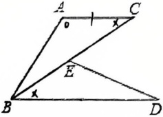

如图， $E$ 为 $BC$ 上一点， $AC \parallel BD$， $AC = BE$， $\angle A = \angle BED$。求证： $AB = ED$。

> [!question]- 点击查看答案与解析
> **【答案】** 证明题
> **【考点】** [[【初中数学知识点体系-人教版】#14-2 三角形全等的判定]]
> **【解析】**
> 证明：$\because AC \parallel BD$（已知），
> $\therefore \angle C = \angle DBE$（两直线平行，内错角相等）。
> 在 $\triangle ACB$ 和 $\triangle BED$ 中：
> $\begin{cases} \angle A = \angle BED \text{（已知）} \\ \angle C = \angle DBE \text{（已证）} \\ AC = BE \text{（已知）} \end{cases}$
> $\therefore \triangle ACB \cong \triangle BED$（AAS）。
> $\therefore AB = ED$（全等三角形对应边相等）。
>
> **【易错点】** 需正确利用平行线性质得到 $\angle C = \angle DBE$（内错角），而非 $\angle C = \angle BED$。
