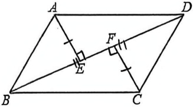

如图， $AE \perp BD$， $CF \perp BD$， $AE = CF$， $BF = DE$。求证： $AB \parallel CD$。

> [!question]- 点击查看答案与解析
> **【答案】** 证明题
> **【考点】** [[【初中数学知识点体系-人教版】#14-2 三角形全等的判定]]
> **【解析】**
> 证明：$\because BF = DE$（已知），
> $\therefore BF + EF = DE + EF$，即 $BE = DF$。
> 在 $\text{Rt}\triangle ABE$ 和 $\text{Rt}\triangle CDF$ 中：
> $\begin{cases} AE = CF \\ BE = DF \end{cases}$
> $\therefore \text{Rt}\triangle ABE \cong \text{Rt}\triangle CDF$（HL）。
> $\therefore \angle ABE = \angle CDF$（全等三角形对应角相等）。
> $\therefore AB \parallel CD$（内错角相等，两直线平行）。
>
> **【易错点】** 注意 $BF = DE$ 转化为 $BE = DF$ 的等量代换；$HL$ 判定仅适用于直角三角形。
