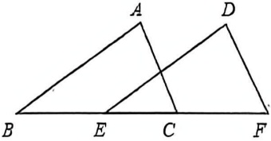

如图，点 B、E、C、F 在同一直线上，AB=DE，AC=DF，BE=CF，求证：AC∥DF.

> [!question]- 点击查看答案与解析
> **【答案】** 证明题
> **【考点】** [[【初中数学知识点体系-人教版】#14-2 三角形全等的判定]]
> **【解析】**
> 证明：$\because BE = CF$（已知），
> $\therefore BE + EC = CF + EC$，即 $BC = EF$。
> 在 $\triangle ABC$ 和 $\triangle DEF$ 中：
> $\begin{cases} AB = DE \\ AC = DF \\ BC = EF \end{cases}$
> $\therefore \triangle ABC \cong \triangle DEF$（SSS）。
> $\therefore \angle ACB = \angle DFE$（全等三角形对应角相等）。
> $\therefore AC \parallel DF$（内错角相等，两直线平行）。
>
> **【易错点】** $BE = CF$ 转化为 $BC = EF$ 的等量代换容易遗漏。
