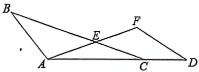

如图，已知点 $A$, $C$, $D$ 在同一直线上， $BC$ 与 $AF$ 交于点 $E$， $AF = AC$， $AB = DF$， $AD = BC$。求证： $\angle ACE = \angle EAC$；

> [!question]- 点击查看答案与解析
> **【答案】** 证明题
> **【考点】** [[【初中数学知识点体系-人教版】#14-1 全等三角形及其性质]]
> **【解析】**
> 证明：在 $\triangle ABC$ 和 $\triangle DFA$ 中：
> $\begin{cases} AB = DF \text{（已知）} \\ BC = AD \text{（已知）} \\ AC = FA \text{（已知）} \end{cases}$
> $\therefore \triangle ABC \cong \triangle DFA$（SSS）。
> $\therefore \angle ACB = \angle FAD$（全等三角形对应角相等）。
> 又 $\because \angle ACE = \angle ACB$，$\angle EAC = \angle FAD$，
> $\therefore \angle ACE = \angle EAC$（等量代换）。
>
> **【易错点】** 不能直接由 $AF = AC$ 得出 $\angle ACE = \angle EAC$，需通过 SSS 证明三角形全等得到对应角相等。
