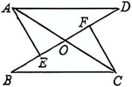

如图，已知 AC、BD 相交于点 O， $AD = BC$， $AE \perp BD$ 于点 E， $CF \perp BD$ 于点 F， $BE = DF$。求证： $\triangle ADE \cong \triangle CBF$；

> [!question]- 点击查看答案与解析
> **【答案】** 证明题
> **【考点】** [[【初中数学知识点体系-人教版】#14-2 三角形全等的判定]]
> **【解析】**
> 证明：$\because AE \perp BD$ 于点 $E$，$CF \perp BD$ 于点 $F$（已知），
> $\therefore \angle AED = \angle CFB = 90^\circ$。
> $\because BE = DF$（已知），
> $\therefore BE + EF = DF + EF$，即 $BF = DE$。
> 在 $\triangle ADE$ 和 $\triangle CBF$ 中：
> $\begin{cases} \angle AED = \angle CFB \\ \angle ADE = \angle CBF \\ AD = CB \end{cases}$
> $\therefore \triangle ADE \cong \triangle CBF$（AAS）。
>
> **【易错点】** 注意 $BE = DF$ 转化为 $BF = DE$ 的等量代换。
