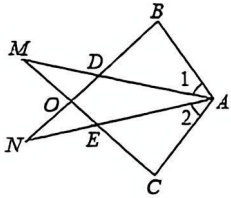

已知 $\triangle ABN$和 $\triangle ACM$的位置如图所示， $\angle 1 = \angle 2$， $AB = AC$， $AM = AN$，求证： $\angle M = \angle N$.

> [!question]- 点击查看答案与解析
> **【答案】** 证明题
> **【考点】** [[【初中数学知识点体系-人教版】#14-2 三角形全等的判定]]
> **【解析】**
> 证明：$\because \angle 1 = \angle 2$（已知），
> $\therefore \angle 1 + \angle BAC = \angle 2 + \angle BAC$，
> 即 $\angle BAN = \angle CAM$。
> 在 $\triangle BAN$ 和 $\triangle CAM$ 中：
> $\begin{cases} AB = AC \\ \angle BAN = \angle CAM \\ AN = AM \end{cases}$
> $\therefore \triangle BAN \cong \triangle CAM$（SAS）。
> $\therefore \angle N = \angle M$（全等三角形对应角相等）。
>
> **【易错点】** $\angle BAN = \angle CAM$ 的推导是证明关键。
