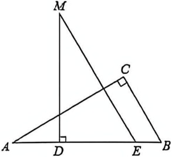

如图，在$\triangle ABC$中，$\angle C=90^\circ$，$D$是$AB$上一点，$DM \perp AB$，且$DM = AC$，过$M$作$ME // BC$交$AB$于$E$、求证：$ME = AB$。

> [!question]- 点击查看答案与解析
> **【答案】** 证明题
> **【考点】** [[【初中数学知识点体系-人教版】#14-2 三角形全等的判定]]
> **【解析】**
> 证明：$\because \angle C = 90^\circ$，$DM \perp AB$（已知），
> $\therefore \angle DME = 90^\circ$。
> $\because ME \parallel BC$（已知），
> $\therefore \angle DEM = \angle B$（两直线平行，同位角相等）。
> 在 $\triangle ABC$ 中，$\angle A = 90^\circ - \angle B$；
> 在 $\triangle DME$ 中，$\angle MDE = 90^\circ - \angle DEM = 90^\circ - \angle B$，
> $\therefore \angle A = \angle MDE$。
> 在 $\triangle ABC$ 和 $\triangle MED$ 中：
> $\begin{cases} \angle C = \angle DME = 90^\circ \\ AC = DM \\ \angle A = \angle MDE \end{cases}$
> $\therefore \triangle ABC \cong \triangle MED$（ASA）。
> $\therefore ME = AB$（全等三角形对应边相等）。
>
> **【易错点】** 需要通过 $\angle A = \angle MDE$ 建立全等条件，注意角的等量代换。
