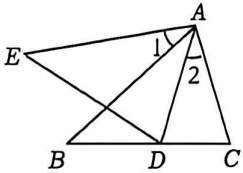

如图所示， $\angle1 = \angle2$，AE = AB，AC = AD．求证：CB = DE．

> [!question]- 点击查看答案与解析
> **【答案】** 证明题
> **【考点】** [[【初中数学知识点体系-人教版】#14-2 三角形全等的判定]]
> **【解析】**
> 证明：$\because \angle 1 = \angle 2$（已知），
> $\therefore \angle 1 + \angle EAC = \angle 2 + \angle EAC$，
> 即 $\angle BAC = \angle EAD$。
> 在 $\triangle ABC$ 和 $\triangle AED$ 中：
> $\begin{cases} AB = AE \\ \angle BAC = \angle EAD \\ AC = AD \end{cases}$
> $\therefore \triangle ABC \cong \triangle AED$（SAS）。
> $\therefore CB = DE$（全等三角形对应边相等）。
>
> **【易错点】** $\angle BAC = \angle EAD$ 的推导是证明关键。
