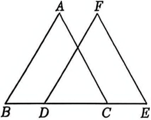

如图， $AB // FD$， $BD = CE$， $\angle A = \angle F$，求证： $\triangle ABC \cong \triangle FDE$。

> [!question]- 点击查看答案与解析
> **【答案】** 证明题
> **【考点】** [[【初中数学知识点体系-人教版】#14-2 三角形全等的判定]]
> **【解析】**
> 证明：$\because AB \parallel FD$（已知），
> $\therefore \angle ABC = \angle FDE$（两直线平行，内错角相等）。
> $\because BD = CE$（已知），
> $\therefore BD + DC = CE + DC$，即 $BC = DE$。
> 在 $\triangle ABC$ 和 $\triangle FDE$ 中：
> $\begin{cases} \angle A = \angle F \\ \angle ABC = \angle FDE \\ BC = DE \end{cases}$
> $\therefore \triangle ABC \cong \triangle FDE$（AAS）。
>
> **【易错点】** $BC = DE$ 需要通过 $BD = CE$ 的等量代换得到，即 $BD + DC = CE + DC$。
