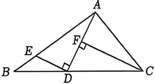

如图， $\angle ADE = \angle CFD = 90^\circ$， $AD = CF$， $DE = DF$。求证： $AE = CD$。

> [!question]- 点击查看答案与解析
> **【答案】** 证明题
> **【考点】** [[【初中数学知识点体系-人教版】#14-2 三角形全等的判定]]
> **【解析】**
> 证明：$\because \angle ADE = \angle CFD = 90^\circ$（已知），
> $\therefore \triangle ADE$ 和 $\triangle CFD$ 是直角三角形。
> 在 $\text{Rt}\triangle ADE$ 和 $\text{Rt}\triangle CFD$ 中：
> $\begin{cases} AD = CF \text{（已知，直角边）} \\ \angle ADE = \angle CFD = 90^\circ \text{（已知，夹角）} \\ DE = DF \text{（已知，直角边）} \end{cases}$
> $\therefore \text{Rt}\triangle ADE \cong \text{Rt}\triangle CFD$（SAS）。
> $\therefore AE = CD$（全等三角形对应边相等）。
>
> **【易错点】** 本题中 $AD = CF$ 和 $DE = DF$ 是两条直角边，夹角为直角，应使用 SAS 而非 HL。
