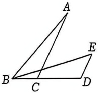

如图，在$\triangle ABC$和$\triangle BED$中，点$C$在$BD$边上，$AB=BE$，$\angle A=\angle DBE$，$AC=BD$，求证：$AC//DE$。

> [!question]- 点击查看答案与解析
> **【答案】** 证明题
> **【考点】** [[【初中数学知识点体系-人教版】#14-2 三角形全等的判定]]
> **【解析】**
> 证明：在 $\triangle ABC$ 和 $\triangle BED$ 中：
> $\begin{cases} AB = BE \text{（已知）} \\ \angle A = \angle DBE \text{（已知）} \\ AC = BD \text{（已知）} \end{cases}$
> $\therefore \triangle ABC \cong \triangle BED$（SAS）。
> $\therefore \angle ACB = \angle BDE$（全等三角形对应角相等）。
> $\because$ 点 $C$ 在 $BD$ 边上，
> $\therefore \angle ACB$ 与 $\angle BDE$ 是直线 $AC$、$DE$ 被直线 $BD$ 所截形成的内错角，
> $\therefore AC \parallel DE$（内错角相等，两直线平行）。
>
> **【易错点】** 由全等得到 $\angle ACB = \angle BDE$ 后，需根据点 $C$ 在 $BD$ 边上判断这两个角是内错角，从而推出平行。
