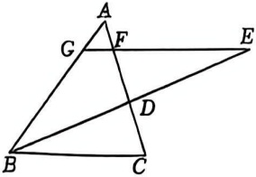

如图，在$\triangle ABC$中，$D$为边$AC$上一点，连接$BD$并延长到点$E$，使$DE=BD$，过点$E$作$EG//BC$，交$AC$于点$F$，交$AB$于点$G$，求证：$GE=BC+GF$。

> [!question]- 点击查看答案与解析
> **【答案】** 证明题
> **【考点】** [[【初中数学知识点体系-人教版】#14-2 三角形全等的判定]]
> **【解析】**
> 证明：$\because EG \parallel BC$（已知），
> $\therefore \angle EFD = \angle C$（两直线平行，内错角相等）。
> $\because BD$ 延长到 $E$，使 $DE = BD$（已知），
> $\therefore BD = DE$。
> 在 $\triangle BDC$ 和 $\triangle EDF$ 中：
> $\begin{cases} \angle BDC = \angle EDF \text{（对顶角相等）} \\ BD = ED \text{（已知）} \\ \angle C = \angle EFD \text{（已证）} \end{cases}$
> $\therefore \triangle BDC \cong \triangle EDF$（ASA）。
> $\therefore BC = EF$（全等三角形对应边相等）。
> $\because GE = GF + FE$（线段和的定义），
> $\therefore GE = GF + BC$（等量代换），
> 即 $GE = BC + GF$。
>
> **【易错点】** 关键是通过 $\triangle BDC \cong \triangle EDF$ 得到 $BC = EF$，再利用线段和的关系直接得出结论，无需额外推导等腰三角形。
