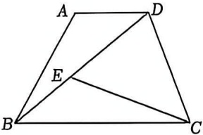

如图，在四边形 $ABCD$ 中， $AD \parallel BC$，点 $E$ 在对角线 $BD$ 上， $BE = AD$ 且 $\angle BEC = \angle A$，求证： $AD + DE = BC$。

> [!question]- 点击查看答案与解析
> **【答案】** 证明题
> **【考点】** [[【初中数学知识点体系-人教版】#14-2 三角形全等的判定]]
> **【解析】**
> 证明：$\because AD \parallel BC$（已知），
> $\therefore \angle ADB = \angle EBC$（两直线平行，内错角相等）。
> 在 $\triangle ABD$ 和 $\triangle ECB$ 中：
> $\begin{cases} \angle A = \angle BEC \text{（已知）} \\ AD = BE \text{（已知）} \\ \angle ADB = \angle EBC \text{（已证）} \end{cases}$
> $\therefore \triangle ABD \cong \triangle ECB$（ASA）。
> $\therefore BD = BC$（全等三角形对应边相等）。
> 又 $\because BD = BE + DE$（线段和的定义），
> 且 $BE = AD$（已知），
> $\therefore BD = AD + DE$（等量代换）。
> $\therefore AD + DE = BC$（等量代换）。
>
> **【易错点】** 需正确识别全等三角形为 $\triangle ABD \cong \triangle ECB$（ASA），而非 $\triangle ADE \cong \triangle CBE$；注意利用 $BD = BC$ 和 $BD = AD + DE$ 进行等量代换得到结论。
