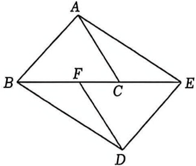

如图，点 $B$、 $F$、 $C$，E 在一条直线上， $FB = CE$，AB // DE，AC // DF．求证：BD = AE

> [!question]- 点击查看答案与解析
> **【答案】** 证明题
> **【考点】** [[【初中数学知识点体系-人教版】#14-2 三角形全等的判定]]
> **【解析】**
> 证明：$\because FB = CE$（已知），
> $\therefore FB + FC = CE + FC$，即 $BC = FE$。
> $\because AB \parallel DE$（已知），
> $\therefore \angle ABC = \angle DEF$（两直线平行，同位角相等）。
> $\because AC \parallel DF$（已知），
> $\therefore \angle ACB = \angle DFE$（两直线平行，同位角相等）。
> 在 $\triangle ABC$ 和 $\triangle DEF$ 中：
> $\begin{cases} \angle ABC = \angle DEF \\ BC = EF \\ \angle ACB = \angle DFE \end{cases}$
> $\therefore \triangle ABC \cong \triangle DEF$（ASA）。
> $\therefore AB = DE$，$AC = DF$。
> $\because AB \parallel DE$ 且 $AB = DE$，
> $\therefore$ 四边形 $ABDE$ 是平行四边形。
> $\therefore BD = AE$（平行四边形对边相等）。
>
> **【易错点】** 需通过 $FB = CE$ 推导 $BC = EF$，再利用 ASA 证明全等，最后用平行四边形性质得到 $BD = AE$。
