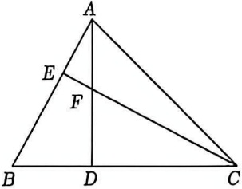

如图，在 $\triangle ABC$中，高AD与高CE交于点F，AD=CD．求证：BD=FD．

> [!question]- 点击查看答案与解析
> **【答案】** 证明题
> **【考点】** [[【初中数学知识点体系-人教版】#14-2 三角形全等的判定]]
> **【解析】**
> 证明：$\because AD \perp BC$，$\angle ADC = 90^\circ$，$AD = CD$（已知），
> $\therefore \triangle ADC$ 是等腰直角三角形，$\angle DCA = 45^\circ$。
> $\because CE \perp AB$，$\therefore \angle BEC = 90^\circ$。
> 在 $\triangle ABD$ 中，$\angle ADB = 90^\circ$，
> $\therefore \angle BAD + \angle ABD = 90^\circ$。
> 在 $\triangle BCF$ 中，$\angle BFC = 90^\circ$，
> $\therefore \angle BCF + \angle ABD = 90^\circ$。
> $\therefore \angle BAD = \angle BCF$（同角的余角相等）。
> 在 $\triangle ABD$ 和 $\triangle CFD$ 中：
> $\begin{cases} \angle BAD = \angle FCD \\ AD = CD \\ \angle ADB = \angle CDF = 90^\circ \end{cases}$
> $\therefore \triangle ABD \cong \triangle CFD$（ASA）。
> $\therefore BD = FD$（全等三角形对应边相等）。
>
> **【易错点】** 需要先由 $AD = CD$ 和 $\angle ADC = 90^\circ$ 推出 $\angle C = 45^\circ$，再利用"同角的余角相等"得到 $\angle BAD = \angle FCD$。
