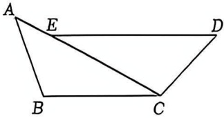

如图，已知 $\triangle ABC$和 $\triangle CDE$，点 $E$在 $AC$上， $DE \parallel BC$， $DE = AC$， $\angle A = \angle D$。

求证： $AB = CD$、

> [!question]- 点击查看答案与解析
> **【答案】** 证明题
> **【考点】** [[【初中数学知识点体系-人教版】#14-2 三角形全等的判定]]
> **【解析】**
> 证明：$\because DE \parallel BC$（已知），
> $\therefore \angle AED = \angle ACB$（两直线平行，同位角相等），
> 即 $\angle CED = \angle ACB$。
> $\because \angle A = \angle D$（已知），
> 在 $\triangle ABC$ 和 $\triangle CDE$ 中：
> $\begin{cases} \angle A = \angle D \\ \angle ACB = \angle CED \\ AC = DE \end{cases}$
> $\therefore \triangle ABC \cong \triangle CDE$（AAS）。
> $\therefore AB = CD$（全等三角形对应边相等）。
>
> **【易错点】** 需要正确识别 $\angle ACB = \angle CED$（由平行线得到），并使用 $AC = DE$ 作为对应边。
