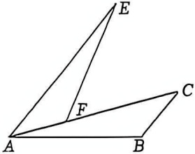

如图， $AE \parallel BC$， $AE = AC$， $\angle EFA = \angle ABC$。求证： $\triangle EFA \cong \triangle ABC$。

> [!question]- 点击查看答案与解析
> **【答案】** 证明题
> **【考点】** [[【初中数学知识点体系-人教版】#14-2 三角形全等的判定]]
> **【解析】**
> 证明：$\because AE \parallel BC$（已知），
> $\therefore \angle EAF = \angle ACB$（两直线平行，同位角相等）。
> 在 $\triangle EFA$ 和 $\triangle ABC$ 中：
> $\begin{cases} \angle EFA = \angle ABC \text{（已知）} \\ \angle EAF = \angle ACB \text{（已证）} \\ AE = AC \text{（已知）} \end{cases}$
> $\therefore \triangle EFA \cong \triangle ABC$（AAS）。
>
> **【易错点】** $\angle EAF = \angle ACB$ 的推导是证明关键。
