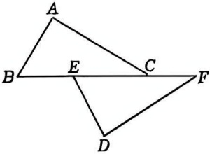

如图，在$\triangle ABC$和$\triangle DEF$中，点$B$，$E$，$C$，$F$在同一条直线上，$AB=DE$，$BE=CF$，$AC=DF$。

（1）求证：$\angle A=\angle D$；（2）若$BF=5$，$CE=2$，求$BC$的长。

> [!question]- 点击查看答案与解析
> **【答案】** 证明题+计算题
> **【考点】** [[【初中数学知识点体系-人教版】#14-1 全等三角形及其性质]]
> **【解析】**
> (1) 证明：$\because BE = CF$（已知），
> $\therefore BE + EC = CF + EC$，即 $BC = EF$。
> 在 $\triangle ABC$ 和 $\triangle DEF$ 中：
> $\begin{cases} AB = DE \\ AC = DF \\ BC = EF \end{cases}$
> $\therefore \triangle ABC \cong \triangle DEF$（SSS）。
> $\therefore \angle A = \angle D$（全等三角形对应角相等）。
>
> (2) 解：$\because \triangle ABC \cong \triangle DEF$（已证），
> $\therefore BC = EF$。
> $\because BE = CF$（已知），
> $\therefore BE + EC = CF + EC$，即 $BC = EF$。
> 又 $\because BC = BE + EC$，$EF = EC + CF$，
> $\therefore BC = EF = BE + EC$。
> $\because BF = 5$，$CE = 2$，
> $\therefore BC = BF - FC = BF - BE = 5 - BE$...
> 设 $BE = x$，则 $BC = x + 2$，$EF = x + 2$。
> $\because BF = BE + EF = x + (x + 2) = 2x + 2 = 5$，
> $\therefore 2x = 3$，$x = 1.5$。
> $\therefore BC = 1.5 + 2 = 3.5$。
>
> **【易错点】** (2) 题中 $BC$ 的计算需要正确处理线段之间的关系。
