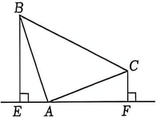

如图，在$\triangle ABC$中，$AB = AC$，$EB = AF$，直线$EF$经过点$A$，$BE \perp EF$于点$E$，$CF \perp EF$于点$F$、求证：$AB \perp AC$。

> [!question]- 点击查看答案与解析
> **【答案】** 证明题
> **【考点】** [[【初中数学知识点体系-人教版】#14-2 三角形全等的判定]]
> **【解析】**
> 证明：$\because BE \perp EF$ 于 $E$，$CF \perp EF$ 于 $F$（已知），
> $\therefore \angle BEA = \angle CFA = 90^\circ$。
> 在 $\text{Rt}\triangle ABE$ 和 $\text{Rt}\triangle ACF$ 中：
> $\begin{cases} AB = AC \text{（已知，斜边）} \\ BE = AF \text{（已知，直角边）} \end{cases}$
> $\therefore \text{Rt}\triangle ABE \cong \text{Rt}\triangle ACF$（HL）。
> $\therefore AE = CF$，$\angle BAE = \angle ACF$（全等三角形对应边、角相等）。
> $\because \angle BAE + \angle EAC = \angle BAC$，
> 又 $\because \angle ACF + \angle FAC = 90^\circ$（在 $\text{Rt}\triangle ACF$ 中），
> 且 $\angle EAC = \angle FAC$（$A$ 在直线 $EF$ 上），
> $\therefore \angle BAC = \angle BAE + \angle EAC = \angle ACF + \angle FAC = 90^\circ$。
> $\therefore AB \perp AC$。
>
> **【易错点】** 需正确识别直角三角形中的斜边和直角边，使用 HL 判定全等。
