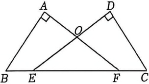

如图，已知 $\angle A = \angle D = 90^\circ$， $E$、 $F$ 在线段 $BC$ 上， $DE$ 与 $AF$ 交于点 $O$，且 $AF = DE$， $BE = CF$。求证： $\text{Rt}\triangle ABF \cong \text{Rt}\triangle DCE$。

> [!question]- 点击查看答案与解析
> **【答案】** 证明题
> **【考点】** [[【初中数学知识点体系-人教版】#14-2 三角形全等的判定]]
> **【解析】**
> 证明：$\because \angle A = \angle D = 90^\circ$（已知），
> $\therefore \triangle ABF$ 和 $\triangle DCE$ 是直角三角形。
> $\because BE = CF$（已知），
> $\therefore BE + EF = CF + EF$，即 $BF = CE$。
> 在 $\text{Rt}\triangle ABF$ 和 $\text{Rt}\triangle DCE$ 中：
> $\begin{cases} BF = CE \text{（已证，斜边）} \\ AF = DE \text{（已知，直角边）} \end{cases}$
> $\therefore \text{Rt}\triangle ABF \cong \text{Rt}\triangle DCE$（HL）。
>
> **【易错点】** $BE = CF$ 转化为 $BF = CE$ 的等量代换；注意使用 HL 判定，其中 $BF = CE$ 是斜边，$AF = DE$ 是直角边。
