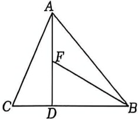

如图，在$\triangle ABC$中，$AD \perp BC$于点$D$，$AC = BF$，$CD = DF$，求证：$Rt\triangle ACD \cong Rt\triangle BFD$。

> [!question]- 点击查看答案与解析
> **【答案】** 证明题
> **【考点】** [[【初中数学知识点体系-人教版】#14-2 三角形全等的判定]]
> **【解析】**
> 证明：$\because AD \perp BC$ 于点 $D$（已知），
> $\therefore \angle ADC = \angle BDF = 90^\circ$。
> 在 $\text{Rt}\triangle ACD$ 和 $\text{Rt}\triangle BFD$ 中：
> $\begin{cases} AC = BF \\ CD = FD \end{cases}$
> $\therefore \text{Rt}\triangle ACD \cong \text{Rt}\triangle BFD$（HL）。
>
> **【易错点】** $HL$ 判定需要直角三角形中的一组斜边和一组直角边对应相等。
