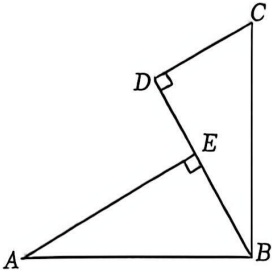

如图，在$\triangle ABE$与$\triangle CBD$中，$AE \perp BD$于点$E$，$CD \perp BD$于点$D$，$AB = BC$，$BE = CD$．证明：$\mathrm{Rt}\triangle ABE \cong \mathrm{Rt}\triangle BCD$．

> [!question]- 点击查看答案与解析
> **【答案】** 证明题
> **【考点】** [[【初中数学知识点体系-人教版】#14-2 三角形全等的判定]]
> **【解析】**
> 证明：$\because AE \perp BD$ 于点 $E$，$CD \perp BD$ 于点 $D$（已知），
> $\therefore \angle AEB = \angle BDC = 90^\circ$。
> 在 $\text{Rt}\triangle ABE$ 和 $\text{Rt}\triangle BCD$ 中：
> $\begin{cases} AB = BC \text{（斜边相等）} \\ BE = CD \text{（直角边相等）} \end{cases}$
> $\therefore \text{Rt}\triangle ABE \cong \text{Rt}\triangle BCD$（HL）。
>
> **【易错点】** $AB$ 和 $BC$ 是斜边，$BE$ 和 $CD$ 是直角边，$HL$ 判定条件需明确。
