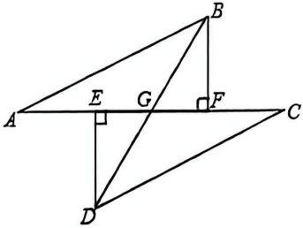

已知：如图点 A，E，F，C 在同一直线上，AE=CF，过 E，F 分别作 DE⊥AC，BF⊥AC，连接 AB，CD，BD，BD 交 AC 于点 G，若 AB=CD，求证：△DEG≌△BFG.

> [!question]- 点击查看答案与解析
> **【答案】** 证明题
> **【考点】** [[【初中数学知识点体系-人教版】#14-2 三角形全等的判定]]
> **【解析】**
> 证明：$\because AE = CF$（已知），
> $\therefore AE + EF = CF + EF$，即 $AF = CE$。
> $\because DE \perp AC$，$BF \perp AC$（已知），
> $\therefore \angle DEA = \angle BFC = 90^\circ$。
> $\because AB = CD$（已知），
> 在 $\text{Rt}\triangle ABF$ 和 $\text{Rt}\triangle CDE$ 中：
> $\begin{cases} AB = CD \text{（已知，斜边）} \\ AF = CE \text{（已证，直角边）} \end{cases}$
> $\therefore \text{Rt}\triangle ABF \cong \text{Rt}\triangle CDE$（HL）。
> $\therefore BF = DE$（全等三角形对应边相等）。
> 在 $\triangle DEG$ 和 $\triangle BFG$ 中：
> $\begin{cases} \angle DEG = \angle BFG = 90^\circ \\ \angle DGE = \angle BGF \text{（对顶角）} \\ DE = BF \text{（已证）} \end{cases}$
> $\therefore \triangle DEG \cong \triangle BFG$（AAS）。
>
> **【易错点】** 需要先通过 HL 证明 $\text{Rt}\triangle ABF \cong \text{Rt}\triangle CDE$ 得到 $BF = DE$，再用 AAS 证明目标全等。
