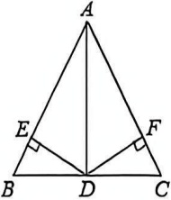

如图，在$\triangle ABC$中，$AB=AC$，点$D$在$BC$上，$DE\perp AB$，$DF\perp AC$，垂足分别为$E$、$F$，$ED=FD$。求证：$AD$是$\triangle ABC$的中线。

> [!question]- 点击查看答案与解析
> **【答案】** 证明题
> **【考点】** [[【初中数学知识点体系-人教版】#14-2 三角形全等的判定]]
> **【解析】**
> 证明：$\because DE \perp AB$ 于 $E$，$DF \perp AC$ 于 $F$（已知），
> $\therefore \angle DEA = \angle DFA = 90^\circ$，
> $\therefore \triangle ADE$ 和 $\triangle ADF$ 都是直角三角形。
> 在 $\text{Rt}\triangle ADE$ 和 $\text{Rt}\triangle ADF$ 中：
> $\begin{cases} AD = AD \text{（公共边，斜边）} \\ DE = DF \text{（已知，直角边）} \end{cases}$
> $\therefore \text{Rt}\triangle ADE \cong \text{Rt}\triangle ADF$（HL）。
> $\therefore \angle BAD = \angle CAD$（全等三角形对应角相等）。
> 在 $\triangle ABD$ 和 $\triangle ACD$ 中：
> $\begin{cases} AB = AC \text{（已知）} \\ \angle BAD = \angle CAD \text{（已证）} \\ AD = AD \text{（公共边）} \end{cases}$
> $\therefore \triangle ABD \cong \triangle ACD$（SAS）。
> $\therefore BD = CD$（全等三角形对应边相等），
> $\therefore D$ 是 $BC$ 的中点，
> $\therefore AD$ 是 $\triangle ABC$ 的中线（中线定义）。
>
> **【易错点】** 注意避免循环论证：不能用 SSS 证 $\triangle ABD \cong \triangle ACD$ 时，不能将待证结论 $BD = CD$ 作为条件；正确思路是先由 HL 证 $\text{Rt}\triangle ADE \cong \text{Rt}\triangle ADF$ 得角相等，再用 SAS 证全等。
