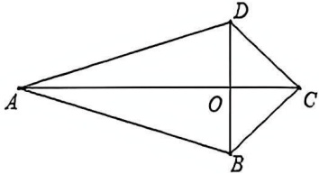

如图，已知 $AB=AD$，BC=DC，BD 与 AC 相交于点 O．求证：OB=OD．

> [!question]- 点击查看答案与解析
> **【答案】** 证明题
> **【考点】** [[【初中数学知识点体系-人教版】#14-1 全等三角形及其性质]]
> **【解析】**
> 证明：在 $\triangle ABC$ 和 $\triangle ADC$ 中：
> $\begin{cases} AB = AD \text{（已知）} \\ BC = DC \text{（已知）} \\ AC = AC \text{（公共边）} \end{cases}$
> $\therefore \triangle ABC \cong \triangle ADC$（SSS）。
> $\therefore \angle BAC = \angle DAC$（全等三角形对应角相等）。
> 在 $\triangle ABO$ 和 $\triangle ADO$ 中：
> $\begin{cases} AB = AD \text{（已知）} \\ \angle BAO = \angle DAO \text{（已证）} \\ AO = AO \text{（公共边）} \end{cases}$
> $\therefore \triangle ABO \cong \triangle ADO$（SAS）。
> $\therefore OB = OD$（全等三角形对应边相等）。
>
> **【易错点】** 需要先证 $\triangle ABC \cong \triangle ADC$ 得到 $\angle BAC = \angle DAC$，再利用 SAS 证 $\triangle ABO \cong \triangle ADO$ 得到 $OB = OD$。
