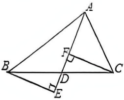

如图， $AD$ 是 $\triangle ABC$ 的中线， $CF \perp AD$ 于点 $F$， $BE \perp AD$，交 $AD$ 的延长线于点 $E$，求证： $AF + AE = 2AD$。

> [!question]- 点击查看答案与解析
> **【答案】** 证明题
> **【考点】** [[【初中数学知识点体系-人教版】#14-2 三角形全等的判定]]
> **【解析】**
> 证明：$\because AD$ 是 $\triangle ABC$ 的中线（已知），
> $\therefore BD = CD$。
> $\because CF \perp AD$ 于 $F$，$BE \perp AD$ 交 $AD$ 延长线于 $E$（已知），
> $\therefore \angle CFD = \angle BED = 90^\circ$。
> 在 $\triangle BED$ 和 $\triangle CFD$ 中：
> $\begin{cases} \angle BED = \angle CFD = 90^\circ \\ \angle BDE = \angle CDF \text{（对顶角）} \\ BD = CD \end{cases}$
> $\therefore \triangle BED \cong \triangle CFD$（AAS）。
> $\therefore DE = DF$，$BE = CF$。
> $\because E$ 在 $AD$ 延长线上，
> $\therefore AE = AD + DE$。
> $\because F$ 在 $AD$ 上，
> $\therefore AF = AD - DF$。
> $\therefore AF + AE = (AD - DF) + (AD + DE) = 2AD + DE - DF$。
> $\because DE = DF$（已证），
> $\therefore DE - DF = 0$。
> $\therefore AF + AE = 2AD$。
>
> **【易错点】** 需正确处理 $E$ 在 $AD$ 延长线上的位置关系，$AE = AD + DE$，$AF = AD - DF$。
