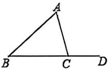

如图， $\angle ACD$ 是  $\triangle ABC$ 的外角，若  $\angle ACD = 110^{\circ}$， $\angle B = 50^{\circ}$，则  $\angle A = (\quad)$

A.  $40^{\circ}$

B.  $50^{\circ}$

C.  $55^{\circ}$

D.  $60^{\circ}$

> [!question]- 点击查看答案与解析
> 【答案】D
> 【考点】[[【初中数学知识点体系-人教版】#13-3 三角形的内角与外角]]
> 【解析】
> - 外角 $\angle ACD = \angle A + \angle B$（外角等于不相邻两内角之和）
> - $110^\circ = \angle A + 50^\circ$
> - $\angle A = 60^\circ$
>
> 【易错点】注意 $\angle ACD$ 是 $\triangle ABC$ 的外角，所以等于 $\angle A$ 与 $\angle B$ 之和。
