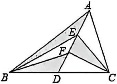

如图 AD 是 $\Delta ABC$ 的中线，点 E、F 是 AD 的三等分点，若 $\Delta ABC$ 的面积为 $30cm^{2}$，则图中阴影部分的面积为( )

A. $5cm^{2}$

B. $10cm^{2}$

C. $15cm^{2}$

D. $20cm^{2}$

> [!question]- 点击查看答案与解析
> 【答案】B
> 【考点】[[【初中数学知识点体系-人教版】#13-2 与三角形有关的线段]]
> 【解析】
> - $AD$ 是中线，$S_{\triangle ABD} = S_{\triangle ACD} = \frac{1}{2} S_{\triangle ABC} = 15$
> - $E$、$F$ 是 $AD$ 的三等分点，将 $AD$ 分成三等份
> - 阴影部分面积为 $\triangle ABC$ 面积的 $\frac{1}{3}$，即 $\frac{1}{3} \times 30 = 10$
>
> 【易错点】需根据图中阴影部分的具体位置计算，利用中线分三角形面积相等的性质。
