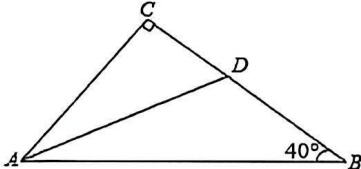

如图，$\triangle ABC$ 中，$\angle C = 90^\circ$，$\angle B = 40^\circ$，$AD$ 是 $\angle BAC$ 的平分线，则 $\angle ADC$ 的度数是( )

A. $25^\circ$

B. $50^\circ$

C. $65^\circ$

D. $70^\circ$

> [!question]- 点击查看答案与解析
> 【答案】C
> 【考点】[[【初中数学知识点体系-人教版】#13-3 三角形的内角与外角]]
> 【解析】
> $\angle C = 90^\circ$，$\angle B = 40^\circ$，$\therefore \angle BAC = 50^\circ$。
> $AD$ 平分 $\angle BAC$，$\therefore \angle BAD = \angle CAD = 25^\circ$。
> 在 $\text{Rt}\triangle ACD$ 中，$\angle C = 90^\circ$，$\angle CAD = 25^\circ$，
> $\therefore \angle ADC = 90^\circ - \angle CAD = 90^\circ - 25^\circ = 65^\circ$。
>
> 【易错点】$\angle ADC$ 在 $\text{Rt}\triangle ACD$ 中计算，不是在 $\text{Rt}\triangle ABD$ 中。
