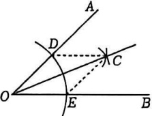

如图，用直尺和圆规作 $\angle AOB$ 的平分线 $OC$，则 $\triangle DOC \cong \triangle EOC$ 的依据是( )

A. SSS

B. SAS

C. ASA

D. AAS

> [!question]- 点击查看答案与解析
> 【答案】A
> 【考点】[[【初中数学知识点体系-人教版】#14-1 全等三角形及其性质]]
> 【解析】
> - 用直尺和圆规作角平分线时，以 $O$ 为圆心画弧交 $OA$、$OB$ 于 $D$、$E$
> - 再以 $D$、$E$ 为圆心画弧交于 $C$
> - 由作图过程可知：$OD = OE$，$DC = EC$，$OC = OC$
> - $\therefore \triangle DOC \cong \triangle EOC$（SSS）
>
> 【易错点】注意 SAS 和 SSS 的区别，本题是 SSS（公共边 + 两条半径 + 两条等弧）。
