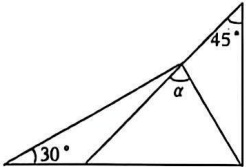

一副三角板按如图所示方式叠放在一起，则图中 $\angle \alpha$ 的度数是 ( )

A. $55^{\circ}$

B. $60^{\circ}$

C. $65^{\circ}$

D. $75^{\circ}$

> [!question]- 点击查看答案与解析
> 【答案】D
> 【考点】[[【初中数学知识点体系-人教版】#6-3 角]]
> 【解析】
> 一副三角板的角度分别为 $45^\circ$-$45^\circ$-$90^\circ$ 和 $30^\circ$-$60^\circ$-$90^\circ$。
> 由图可知，$\angle \alpha$ 是 $45^\circ$ 三角板的一个角与 $30^\circ$ 三角板的一个角拼合而成，
> $\angle \alpha = 45^\circ + 30^\circ = 75^\circ$。
>
> - A. $55^\circ$：无法由两块三角板的角度拼合得到，错误
> - B. $60^\circ$：是 $30^\circ$-$60^\circ$-$90^\circ$ 三角板的一个角，但不是图中 $\alpha$ 的值，错误
> - C. $65^\circ$：无法由两块三角板的角度拼合得到，错误
> - D. $75^\circ = 45^\circ + 30^\circ$，符合图中拼合方式，正确
>
> 【易错点】需要正确识别 $\angle \alpha$ 是由哪两个角拼合而成，注意区分角的和与差。
