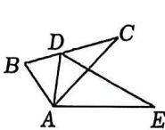

如图，$\triangle ABC \cong \triangle ADE$，$\angle B = 80^\circ$，$\angle C = 30^\circ$，$\angle DAC = 35^\circ$，则 $\angle EAC$ 的度数为( )

A. $40^\circ$

B. $30^\circ$

C. $35^\circ$

D. $25^\circ$

> [!question]- 点击查看答案与解析
> 【答案】C
> 【考点】[[【初中数学知识点体系-人教版】#14-1 全等三角形及其性质]]
> 【解析】
> $\because \triangle ABC \cong \triangle ADE$，
> $\therefore \angle BAC = \angle DAE$（全等三角形对应角相等）。
> $\angle BAC = 180^\circ - \angle B - \angle C = 180^\circ - 80^\circ - 30^\circ = 70^\circ$，
> $\therefore \angle DAE = 70^\circ$。
> $\because \angle DAC = 35^\circ$，
> $\therefore \angle EAC = \angle DAE - \angle DAC = 70^\circ - 35^\circ = 35^\circ$。
>
> 【易错点】注意 $\angle EAC$ 是 $\angle DAE$ 与 $\angle DAC$ 的差，不是和。
