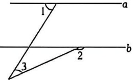

如图所示，$a // b$，则下列式子的值为 $180^\circ$ 的是( )

A.  $\angle 1 + \angle 2 + \angle 3$

B.  $\angle 1 + \angle 2 - \angle 3$

C.  $\angle 2 + \angle 3 - \angle 1$

D.  $\angle 1 - \angle 2 + \angle 3$

> [!question]- 点击查看答案与解析
> 【答案】A
> 【考点】[[【初中数学知识点体系-人教版】#7-2 平行线]]
> 【解析】
> 如图，过折点作 $a$ 的平行线（即作辅助线平行于 $a$、$b$）。
> $\because a \parallel b$，设辅助线将 $\angle 1$、$\angle 2$、$\angle 3$ 分成若干部分。
> 由平行线的内错角相等和三角形外角定理，可推导：
> $\angle 1 + \angle 2 + \angle 3 = 180^\circ$。
>
> 【易错点】需要正确作辅助线，利用平行线的内错角关系建立三个角的等量关系。
