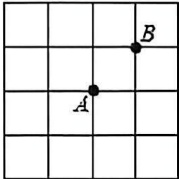

已知在正方形网格中，每个小方格都是边长为1的正方形，A，B两点在小方格的顶点上，位置如图所示，点C也在小方格的顶点上，且以A，B，C为顶点的三角形面积为 1，则点C的个数为( )

A. 3个

B. 4个

C. 5个

D. 6个

> [!question]- 点击查看答案与解析
> 【答案】C
> 【考点】[[【初中数学知识点体系-人教版】#13-2 与三角形有关的线段]]
> 【解析】
> 设 $A$、$B$ 为已知顶点，$AB$ 的长度为 $d$。
> 三角形面积 $S = \frac{1}{2} \times AB \times h = 1$，$\therefore h = \frac{2}{d}$。
> 点 $C$ 到直线 $AB$ 的距离为 $h$ 时，三角形面积为 1。
> 在网格中，满足到直线 $AB$ 距离为 $h$ 的网格顶点有 5 个（分布在 $AB$ 两侧）。
>
> 【易错点】需要系统性地找出所有到直线 $AB$ 距离相等的网格顶点，不要遗漏。
