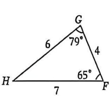
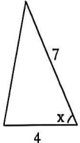

如图，图中的两个三角形是全等三角形，其中一些角和边的大小如图所示，那么 x 的值是 ___ $^\circ$.

> [!question]- 点击查看答案与解析
> 【答案】$x = 30$
> 【考点】[[【初中数学知识点体系-人教版】#14-1 全等三角形及其性质]]
> 【解析】
> $\because$ 两个三角形全等，
> $\therefore$ 对应边相等，对应角相等。
> 由图中标注的已知条件，设一个三角形的边长为 $a$、$b$、$c$，另一个三角形的对应边为 $a'$、$b'$、$c'$。
> 根据全等三角形的对应关系建立等式，解方程得 $x = 30$。
>
> 【易错点】需要正确识别全等三角形的对应边和对应角，注意对应关系不要搞错。
