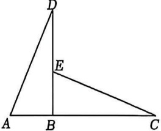

如图，$A$， $B$， $C$三点共线，$D$， $E$， $B$三点共线，且 $\triangle ABD \cong \triangle EBC$，$AB = 5$，$BC = 12$，则 $DE$ 的长为 ___ .

> [!question]- 点击查看答案与解析
> 【答案】7
> 【考点】[[【初中数学知识点体系-人教版】#14-1 全等三角形及其性质]]
> 【解析】
> - $\triangle ABD \cong \triangle EBC$
> - $AB = EB = 5$，$BD = BC = 12$
> - $A$、$B$、$C$ 三点共线，$D$、$E$、$B$ 三点共线
> - $DE = DB - BE = 12 - 5 = 7$
>
> 【易错点】注意 $B$ 在 $DE$ 之间还是 $D$、$E$ 在 $B$ 两侧，本题是 $D$、$E$ 在 $B$ 两侧还是 $B$ 在中间。
