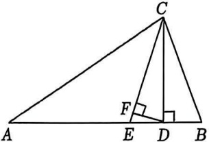

如图，$\triangle ABC$ 中，$\angle A = 40^\circ$，$\angle B = 80^\circ$，$CE$ 平分 $\angle ACB$，$CD \perp AB$ 于 $D$，$DF \perp CE$，则 $\angle CDF$ 的度数 = ___ .

> [!question]- 点击查看答案与解析
> 【答案】$70^\circ$
> 【考点】[[【初中数学知识点体系-人教版】#13-3 三角形的内角与外角]]
> 【解析】
> $\because \angle A = 40^\circ$，$\angle B = 80^\circ$，
> $\therefore \angle ACB = 180^\circ - 40^\circ - 80^\circ = 60^\circ$。
> $\because CE$ 平分 $\angle ACB$，
> $\therefore \angle ACE = \angle BCE = 30^\circ$。
> $\because CD \perp AB$ 于 $D$，
> $\therefore \angle CDA = 90^\circ$。
> 在 $\text{Rt}\triangle CDA$ 中，$\angle DCA = 90^\circ - \angle A = 90^\circ - 40^\circ = 50^\circ$。
> $\therefore \angle DCE = \angle DCA - \angle ACE = 50^\circ - 30^\circ = 20^\circ$。
> $\because DF \perp CE$ 于 $F$，
> $\therefore \angle DFC = 90^\circ$。
> 在 $\text{Rt}\triangle DFC$ 中，$\angle CDF = 90^\circ - \angle DCE = 90^\circ - 20^\circ = 70^\circ$。
>
> 【易错点】注意 $\angle CDF$ 与 $\angle DCE$ 互余（都在 $\text{Rt}\triangle DFC$ 中），不要混淆。
