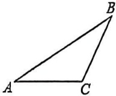

如图，已知 $\triangle ABC$

（1）画出 $\Delta ABC$的高 AD；

（2）尺规作出 $\Delta ABC$的角平分线 BE（要求保留作图痕迹，不用证明）；

（3）画出 $\Delta ABC$的中线 $CF$．

> [!question]- 点击查看答案与解析
> 【答案】作图题
> 【考点】[[【初中数学知识点体系-人教版】#13-2 与三角形有关的线段]]
> 【解析】
> - 高 $AD$：过 $A$ 作 $BC$ 的垂线，垂足为 $D$
> - 角平分线 $BE$：以 $B$ 为圆心画弧，分别交 $BA$、$BC$ 于两点；再以这两点为圆心画弧交于一点，连接 $B$ 与此点即为 $\angle B$ 的平分线 $BE$
> - 中线 $CF$：取 $AB$ 的中点，连接 $C$ 与此中点即为中线 $CF$
>
> 【易错点】中线是连接顶点与对边中点的线段，不是垂直的。
