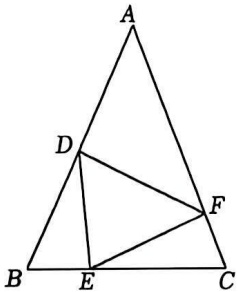

填空，完成下列证明过程.

如图，$\triangle ABC$ 中，$\angle B = \angle C$，$D$，$E$，$F$ 分别在 $AB$，$BC$，$AC$ 上，且 $BD = CE$，$\angle DEF = \angle B$。求证：$ED = EF$.

证明：∵$\angle DEC = \angle B + \angle BDE = \angle DEF + \angle FEC$，

又 $\because \angle DEF = \angle B$（已知），

 $\therefore \angle$ ___ =  $\angle$ ___ （等式性质）.

在 $\triangle EBD$与 $\triangle FCE$中，

$\begin{cases} \angle \underline{\quad\quad} = \angle \underline{\quad\quad} \\ \underline{\quad\quad} = \underline{\quad\quad} \\ \angle B = \angle C \end{cases}$

$\therefore \triangle EBD \cong \triangle FCE (\_\_\_)$

$\therefore ED = EF(\_\_\_).$

> [!question]- 点击查看答案与解析
> 【答案】证明题
> 【考点】[[【初中数学知识点体系-人教版】#14-2 三角形全等的判定]]
> 【解析】
> 证明：$\because \angle DEC = \angle B + \angle BDE = \angle DEF + \angle FEC$（外角性质），
> 又 $\because \angle DEF = \angle B$（已知），
> $\therefore \angle BDE = \angle FEC$（等式性质）。
> 在 $\triangle EBD$ 与 $\triangle FCE$ 中：
> $\begin{cases} \angle BDE = \angle FEC \\ \angle B = \angle C \\ BD = CE \end{cases}$
> $\therefore \triangle EBD \cong \triangle FCE$（AAS）。
> $\therefore ED = EF$（全等三角形对应边相等）。
>
> 【易错点】由 $\angle DEC$ 的两种表达形式推出 $\angle BDE = \angle FEC$ 是关键步骤。
