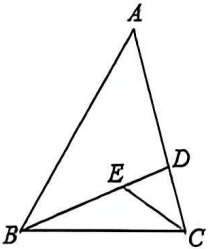

如图，$\angle A = 65^{\circ}$，$\angle ABD = 30^{\circ}$，$\angle ACB = 72^{\circ}$，且CE平分 $\angle ACB$，求 $\angle DEC$的度数.

> [!question]- 点击查看答案与解析
> 【答案】$49^\circ$
> 【考点】[[【初中数学知识点体系-人教版】#13-3 三角形的内角与外角]]
> 【解析】
> $\because \angle A = 65^\circ$，$\angle ABD = 30^\circ$，
> 在 $\triangle ABD$ 中，$\angle ADB = 180^\circ - \angle A - \angle ABD = 180^\circ - 65^\circ - 30^\circ = 85^\circ$。
> $\therefore \angle BDC = 180^\circ - \angle ADB = 95^\circ$。
> $\because \angle ACB = 72^\circ$，$CE$ 平分 $\angle ACB$，
> $\therefore \angle ACE = \angle BCE = 36^\circ$。
> 在 $\triangle BDC$ 中，$\angle DBC = 180^\circ - \angle BDC - \angle BCD = 180^\circ - 95^\circ - 72^\circ = 13^\circ$。
> $\angle DEC$ 是 $\triangle BCE$ 的外角，$\angle DEC = \angle EBC + \angle BCE = 13^\circ + 36^\circ = 49^\circ$。
>
> 【易错点】需要正确识别 $\angle DEC$ 是哪个三角形的外角，并正确应用外角定理。注意 $\angle BCE = 36^\circ$ 而非 $70^\circ$。
