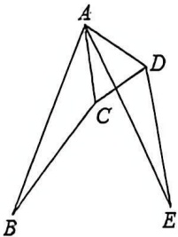

已知：如图，$CB = DE$，$\angle B = \angle E$，$\angle BAE = \angle CAD$。求证：AC=AD.

> [!question]- 点击查看答案与解析
> 【答案】证明题
> 【考点】[[【初中数学知识点体系-人教版】#14-2 三角形全等的判定]]
> 【解析】
> 证明：$\because \angle BAE = \angle CAD$（已知），
> $\therefore \angle BAE + \angle EAC = \angle CAD + \angle EAC$，
> 即 $\angle BAC = \angle EAD$。
> 在 $\triangle ABC$ 和 $\triangle AED$ 中：
> $\begin{cases} \angle B = \angle E \\ \angle BAC = \angle EAD \\ CB = DE \end{cases}$
> $\therefore \triangle ABC \cong \triangle AED$（AAS）。
> $\therefore AC = AD$（全等三角形对应边相等）。
>
> 【易错点】$\angle BAC = \angle EAD$ 的推导是证明关键。
