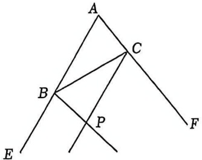

如图，已知在 $\triangle ABC$ 中，$\angle ABC$ 和 $\angle ACB$ 的外角平分线相交于点$P$.

（1）若 $\angle ABC = 30^\circ$，$\angle ACB = 70^\circ$，求 $\angle BPC$ 的度数；

（2）若 $\angle ABC = \alpha$，$\angle BPC = \beta$，求 $\angle ACB$ 的度数.

> [!question]- 点击查看答案与解析
> 【答案】(1) $50^\circ$；(2) $\angle ACB = 2\beta - \alpha$
> 【考点】[[【初中数学知识点体系-人教版】#13-3 三角形的内角与外角]]
> 【解析】
> (1) $\because BP$、$CP$ 分别平分 $\angle ABC$ 的外角和 $\angle ACB$ 的外角，
> $\therefore \angle PBC = 90^\circ - \frac{1}{2}\angle ABC$，$\angle PCB = 90^\circ - \frac{1}{2}\angle ACB$。
> $\angle BPC = 180^\circ - \angle PBC - \angle PCB = 180^\circ - 180^\circ + \frac{1}{2}(\angle ABC + \angle ACB)$
> $= \frac{1}{2}(180^\circ - \angle A) = 90^\circ - \frac{1}{2}\angle A$
> 当 $\angle ABC = 30^\circ$，$\angle ACB = 70^\circ$ 时，$\angle A = 80^\circ$，
> $\angle BPC = 90^\circ - 40^\circ = 50^\circ$。
>
> (2) 设 $\angle ACB = \gamma$，则 $\angle ABC$ 的外角 $= 180^\circ - \alpha$，$\angle ACB$ 的外角 $= 180^\circ - \gamma$。
> $\angle PBC = \frac{1}{2}(180^\circ - \alpha)$，$\angle PCB = \frac{1}{2}(180^\circ - \gamma)$。
> $\beta = 180^\circ - \frac{1}{2}(180^\circ - \alpha) - \frac{1}{2}(180^\circ - \gamma) = \frac{1}{2}(\alpha + \gamma)$。
> $\therefore \gamma = 2\beta - \alpha$，即 $\angle ACB = 2\beta - \alpha$。
>
> 【易错点】注意是"外角"的平分线，需用 $180^\circ$ 减去内角后再取一半。
