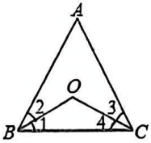

如图，BO、CO分别平分 $\angle ABC$和 $\angle ACB$，

（1）若 $\angle A = 60^\circ$ 时，则 $\angle O =$ ___ 度

（2）若 $\angle A=100^\circ$ 时，则 $\angle O=$ ___ 度

（3）由（1）、（2）你发现了什么规律？当 $\angle A$ 的度数发生变化后，你的结论仍成立吗？（提示：三角形的内角和等于 $180^{\circ}$）

> [!question]- 点击查看答案与解析
> 【答案】(1) $120^\circ$；(2) $140^\circ$；(3) 规律：$\angle O = 90^\circ + \frac{1}{2}\angle A$
> 【考点】[[【初中数学知识点体系-人教版】#13-3 三角形的内角与外角]]
> 【解析】
> (1) $\because BO$、$CO$ 分别平分 $\angle ABC$ 和 $\angle ACB$，
> $\therefore \angle OBC = \frac{1}{2}\angle ABC$，$\angle OCB = \frac{1}{2}\angle ACB$。
> $\angle O = 180^\circ - \angle OBC - \angle OCB = 180^\circ - \frac{1}{2}(\angle ABC + \angle ACB)$
> $= 180^\circ - \frac{1}{2}(180^\circ - \angle A) = 180^\circ - 90^\circ + \frac{1}{2}\angle A = 90^\circ + \frac{1}{2}\angle A$
> 当 $\angle A = 60^\circ$ 时，$\angle O = 90^\circ + 30^\circ = 120^\circ$。
>
> (2) 当 $\angle A = 100^\circ$ 时，$\angle O = 90^\circ + 50^\circ = 140^\circ$。
>
> (3) 规律：$\angle O = 90^\circ + \frac{1}{2}\angle A$
> 证明：由(1)(2)的推导过程知 $\angle O = 90^\circ + \frac{1}{2}\angle A$。
> 当 $\angle A$ 发生变化时，此结论仍然成立。
>
> 【易错点】$\angle O$ 与 $\angle A$ 的关系式是 $90^\circ + \frac{1}{2}\angle A$，注意符号。
