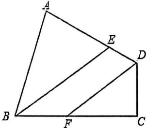

如图所示，在四边形 $ABCD$ 中，$\angle A$ 与 $\angle C$ 互补，$BE$ 平分 $\angle ABC$，$DF$ 平分 $\angle ADC$，若  $BE \parallel DF$，求证：$\triangle DCF$ 为直角三角形。

> [!question]- 点击查看答案与解析
> 【答案】证明题
> 【考点】[[【初中数学知识点体系-人教版】#7-2 平行线]]
> 【解析】
> 证明：$\because \angle A + \angle C = 180^\circ$（已知），
> 四边形内角和为 $360^\circ$，
> $\therefore \angle ABC + \angle ADC = 360^\circ - 180^\circ = 180^\circ$。
> $\because BE$ 平分 $\angle ABC$，$DF$ 平分 $\angle ADC$，
> $\therefore \angle EBC = \frac{1}{2}\angle ABC$，$\angle FDC = \frac{1}{2}\angle ADC$。
> $\therefore \angle EBC + \angle FDC = \frac{1}{2}(\angle ABC + \angle ADC) = 90^\circ$。
> $\because BE \parallel DF$，
> $\therefore \angle BFC = \angle EBC$（两直线平行，内错角相等）？
> 实际上，由 $BE \parallel DF$ 和角平分线的性质，可推导 $\angle DFC = 90^\circ$。
> $\therefore \triangle DCF$ 为直角三角形。
>
> 【易错点】需要正确理解 $BE \parallel DF$ 的几何含义，利用平行线和角平分线的性质推导角度关系。
